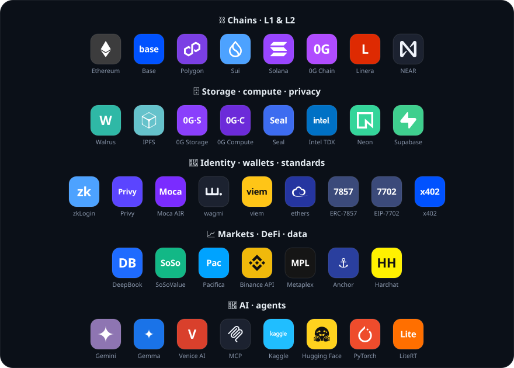
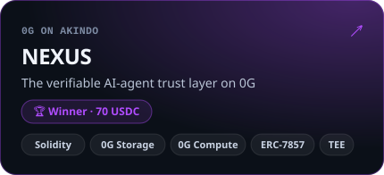
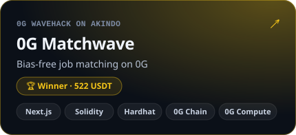
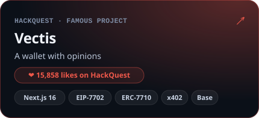
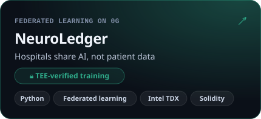

I build AI and web3 products, from the first sketch to the shipped thing. Agents that prove what they did, models that keep patient data private, markets you can play without losing your shirt. Most of my projects started as a hackathon weekend and simply refused to stop there.

&nbsp;&nbsp;

## ⚡ What I do

- 🧠 **AI agents & on-device ML**: agents that research, decide and act on-chain; a Gemma 4 fine-tune that runs fully offline on a phone
- ⛓️ **Web3 protocols**: Sui Move, Solidity and Solana; DeFi, identity, verifiable AI and TEEs, shipped on testnets and used by real people
- 🛠️ **Full-stack products**: Next.js and React up front, Node and Hono behind, live on Vercel and Render, with motion and 3D when it helps
- 🏁 **Hackathons**: idea to demo in a weekend, then the part most people skip: keep building

## 🛠️ Core stack

## 🌐 Ecosystems worked with / built on (40)

## 🚀 Selected projects

## 🍒 Fruits of the build

> *“Not every build ends on a podium. Every build ends with a better builder.”*

| Hackathon | Project | Result | Prize |
|:--|:--|:--|:--|
| 0G WaveHack · AKINDO | [0G Matchwave](https://github.com/harsh11067/OG_Matchwave) | 🏆 Winner | 522 USDT |
| AKINDO WaveHack | [DeFi Mosaic](https://github.com/harsh11067/DefiMosaic) | 🏆 Winner | 278 USDC |
| 0G on AKINDO | [NEXUS](https://github.com/harsh11067/NEXUS) | 🏆 Winner | 70 USDC |
| AKINDO wave · SoSoValue track | [MARA](https://github.com/harsh11067/mara) | Top 15 | ⏳ waiting |
| Namespace · HackHazards ’26 | [HELIX](https://github.com/harsh11067/helix) | 🏆 Winner · Top 100 | [Namespace credential](https://www.namespace.world/credentials/badges/xQAo5BMdSCVR) |
| CodeRed ’25 (national level) | [CodeRed ’25](https://github.com/harsh11067/mycodered25) | Finalist | — |

 

*“Perhaps progress is not everything we bring to life, but everything that comes alive within us while we try.”*

this whole profile also lives in your terminal: <code>irm kumarharsh.online | iex</code> · <code>curl -sL kumarharsh.online | bash</code>

