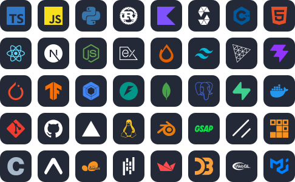
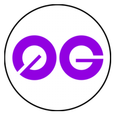
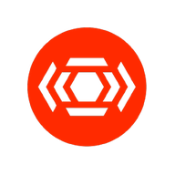
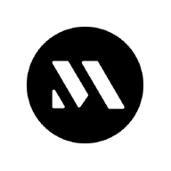
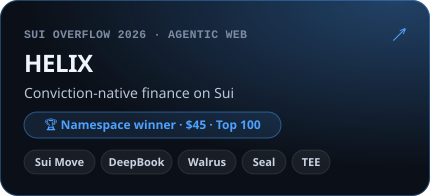
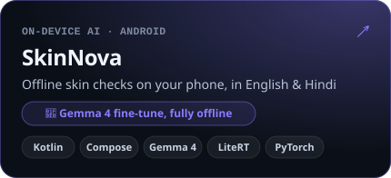
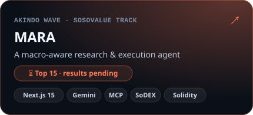
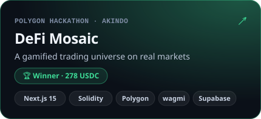

I build AI and web3 products, from the first sketch to the shipped thing. Agents that prove what they did, models that keep patient data private, markets you can play without losing your shirt. Most of my projects started as a hackathon weekend and simply refused to stop there.

&nbsp;&nbsp;

## ⚡ What I do

I take a product from a thought in my head to something people actually use. I imagine the idea, learn whatever it needs, find the nerve to commit, design the whole thing end to end, then direct the build like a lead engineer, orchestrating a crew of AI coding agents through specs, reviews and tests, before I test it hard and ship it.

- 📱 **On-device ML**: models that run where the data lives, like SkinNova's Gemma 4 fine-tune that works fully offline on a phone
- 🤖 **AI agents**: agents that research, decide and act on-chain, and can prove what they did
- 🧩 **Full stack**: Next.js and React up front, Node and Hono behind, smart contracts underneath, shipped live
- 🏁 **Hackathons**: idea to demo in a weekend, then the part most people skip: keep building

## 🛠️ Core stack & technologies

## 🌐 Ecosystems worked with / built on (30+)

**⛓️ Layer 1 & Layer 2**

&nbsp;&nbsp;&nbsp;&nbsp;&nbsp;&nbsp;

**🧱 Infrastructure & tooling**

&nbsp;&nbsp;&nbsp;&nbsp;&nbsp;&nbsp;

**🔐 Privacy, identity & wallets**

&nbsp;&nbsp;&nbsp;&nbsp;&nbsp;

**📈 DeFi & markets**

&nbsp;&nbsp;&nbsp;&nbsp;

**🧠 AI & agents**

&nbsp;&nbsp;&nbsp;&nbsp;

## 🚀 Selected projects

## 🍒 Fruits of the build

> *“Not every build ends on a podium. Every build ends with a better builder.”*

| Hackathon | Project | Result |
|:--|:--|:--|
| 0G WaveHack · AKINDO | [0G Matchwave](https://github.com/harsh11067/OG_Matchwave) | 🏆 Winner |
| Polygon hackathon · AKINDO | [DeFi Mosaic](https://github.com/harsh11067/DefiMosaic) | 🏆 Winner |
| Namespace · HackHazards ’26 | [HELIX](https://github.com/harsh11067/helix) | 🏆 Winner · Top 100 |
| HackQuest | [Vectis](https://www.hackquest.io/projects/vectis) | ⭐ Top rated · 15,858 likes |
| AKINDO wave · SoSoValue track | [MARA](https://github.com/harsh11067/mara) | 🎯 Top 15 · results pending |
| CodeRed ’25 · national level | [CodeRed ’25](https://github.com/harsh11067/mycodered25) | 🎖️ Finalist |

 

*“Perhaps progress is not everything we bring to life, but everything that comes alive within us while we try.”*

this profile also lives in your terminal: <code>irm kumarharsh.online | iex</code> · <code>curl -sL kumarharsh.online | bash</code>

